# ecgdig: classical ECG image digitizer

ecgdig turns a picture of a paper ECG (scan, rasterized PDF or phone photo) into 12-lead signals in mV at 500 Hz using only classical computer vision: grid geometry, mathematical morphology, dynamic programming and physiological constraints. There is no trained model. Layout, speed, duration and gain are found on the image.

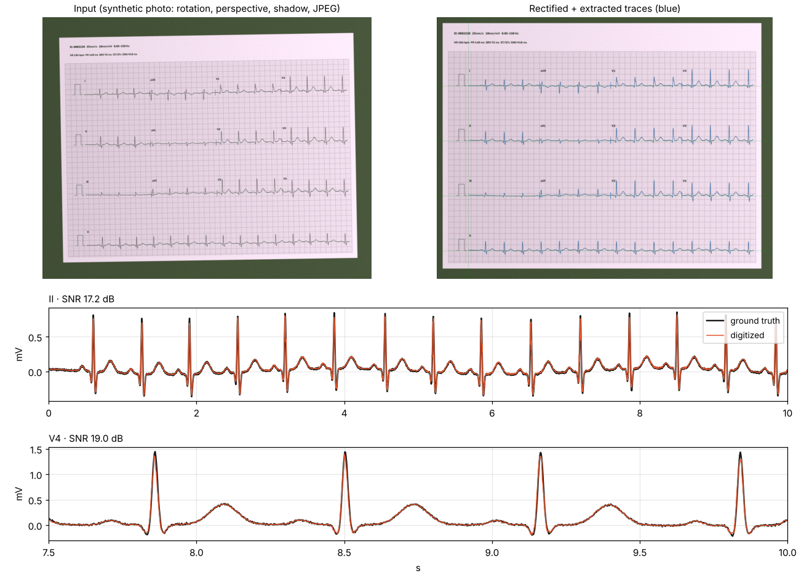

## Results

Current numbers (Nov 21, 2026). Hybrid = the classical pipeline with the learned row network
(rowheavy3e), the page-structure network (page v3) and the photometric normalisation; classical =
no network (Nov 19-20 numbers, before the normalisation):

| Benchmark | ecgdig hybrid | ecgdig classical | Reference |
|---|---|---|---|
| [PM-ECG-ID](benchmarks/pmcardio/), whole database (6,000 ECGs, 60 capture scenarios), PMcardio-style SNR | **10.43 dB** (5,918 ECGs, 98.6%; PCC 0.753, 9.2% failed leads) | 8.51 dB (PCC 0.686, 13.6% failed leads) | PMcardio: 14.48 dB (60-subset mean of its paper); 14.05 dB, PCC 0.885, 6.62% failed in its supplementary table |
| [PhysioNet (Kaggle)](benchmarks/physionet/) training records, all 8,793 images, official metric | **18.30 dB** (8,352 images, 95%; holdout records never trained on: 18.21) | 17.58 dB (8,352 images, 95%) | leaders 22.6-23.3 dB on the hidden test (other images) |
| Kaggle hidden test, official late submission | not submitted yet | 13.03 dB (private) | 1st place 23.33 dB |
| [LITFL](benchmarks/litfl/), real pages without a signal ground truth (70 of the 102 the site served to CI) | | layout 93%, rhythm strips 94%, layout + speed + duration + gain 91% | hand-reviewed reference |

SNR and PCC follow each benchmark's own metric: per lead, with a small time alignment and the
offset removed; on PM-ECG-ID a lead that is missing or less than half covered counts as SNR 0 and
PCC 0. The Kaggle metric is the competition's (mean of linear image SNRs, then dB).

Documentation:

| Document | What |
|---|---|
| [`docs/experiments-log.md`](docs/experiments-log.md) | every training and evaluation, with coverage, card, hours and cost |
| [`docs/leaderboard.md`](docs/leaderboard.md) | the development leaderboard (same sets for every experiment) |
| [`docs/roadmap.md`](docs/roadmap.md) | what comes next |
| [`docs/lessons.md`](docs/lessons.md) | what worked, what did not, mistakes not to repeat |
| [`docs/infrastructure.md`](docs/infrastructure.md) | GitHub Actions + RunPod: architecture, rebuild from zero, recipes, costs |
| [`docs/runpod-troubleshooting.md`](docs/runpod-troubleshooting.md) | every RunPod problem met, how to recognise it, what it cost, the safeguard |
| [`docs/kaggle-insights.md`](docs/kaggle-insights.md) | what the top Kaggle solutions did |
| [`docs/hybrid.md`](docs/hybrid.md) | the learned components inside the classical pipeline |
| [`docs/evaluation-and-roadmap.md`](docs/evaluation-and-roadmap.md) | history of the classical pipeline (Nov 12-16) |
| [`docs/results/`](docs/results/) | per-scenario and per-type tables of each whole-database run |

## Examples on PM-ECG-ID

Each figure shows the input image, the page rectified by the grid with the extracted trace in blue, and one lead against the ground truth (blue = truth, red = ecgdig). The numbers on each figure are measured with the PM-ECG-ID metric. Images: [PM-ECG-ID](https://doi.org/10.5281/zenodo.13617673) (Iring et al., 2024, GPL-3.0-or-later).

### Good

| | |
|---|---|
| 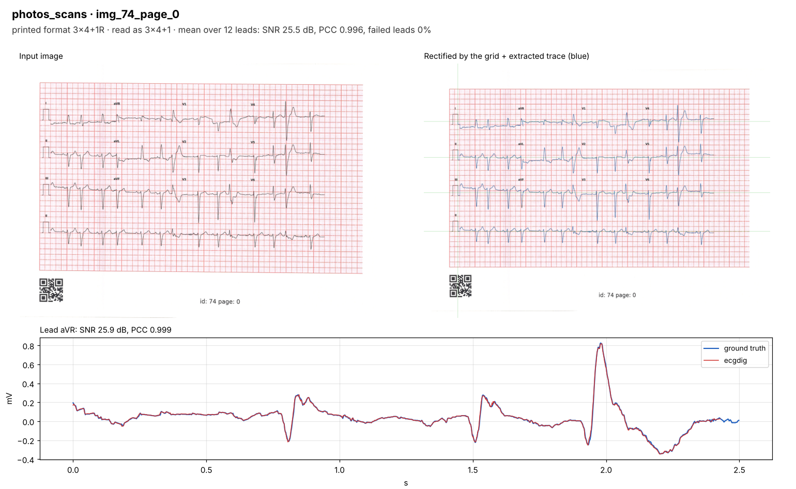 | 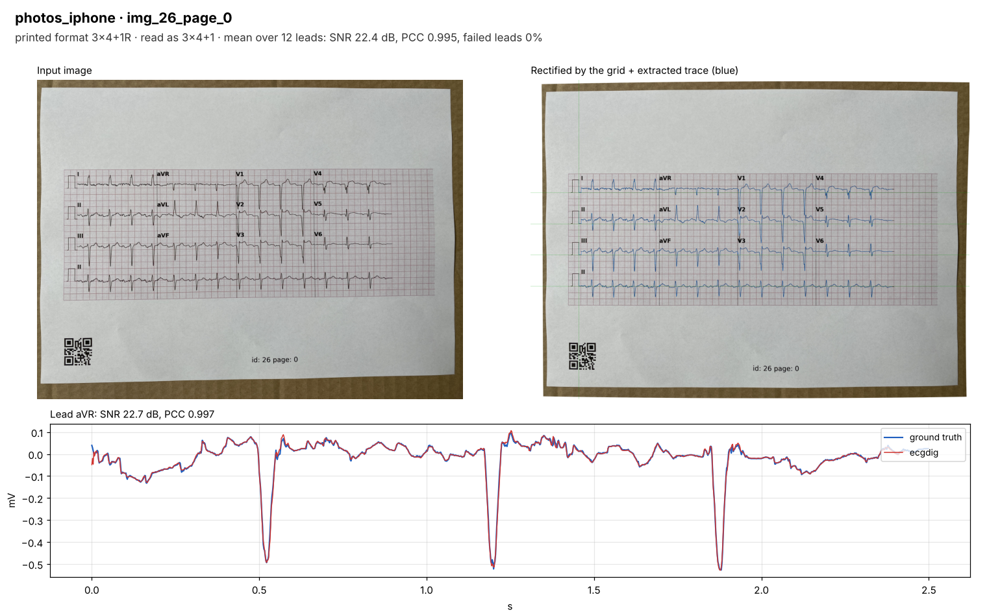 |
| Desk scan, 3x4 + rhythm II (25.5 dB) | Phone photo on cardboard, 3x4 + rhythm II (22.5 dB) |
| 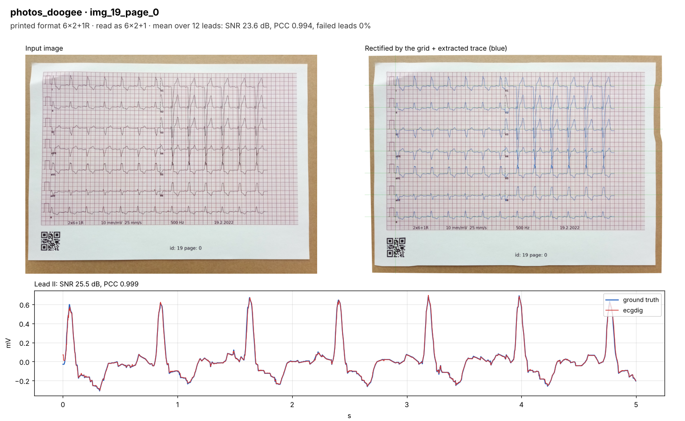 | 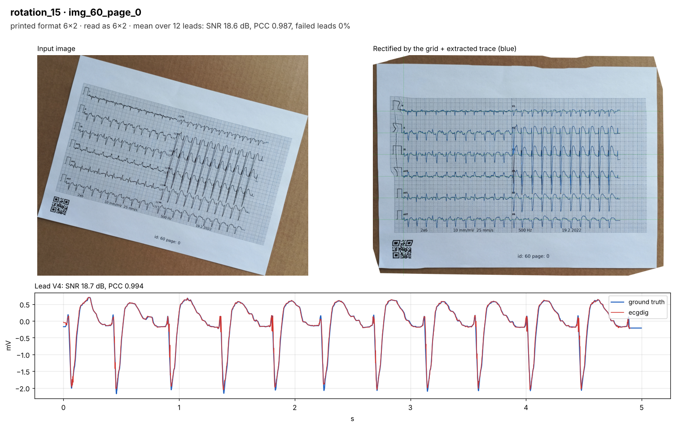 |
| Phone photo, 6x2 + rhythm (23.5 dB) | Rotated 15°, 6x2 (18.6 dB) |
| 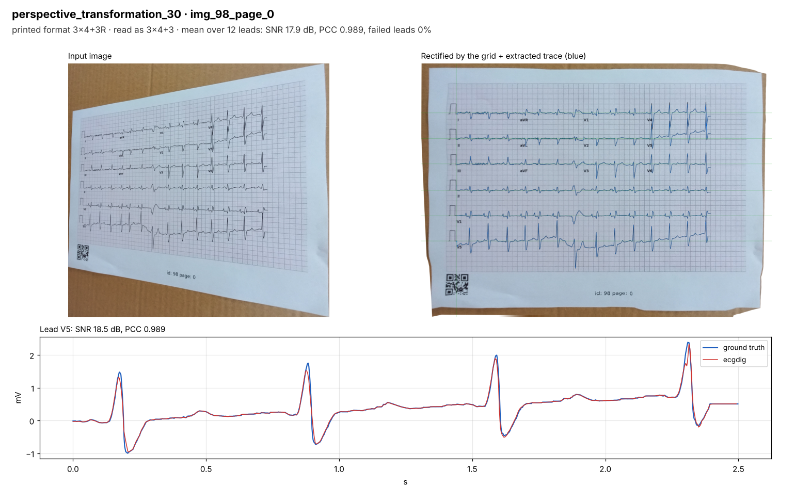 | 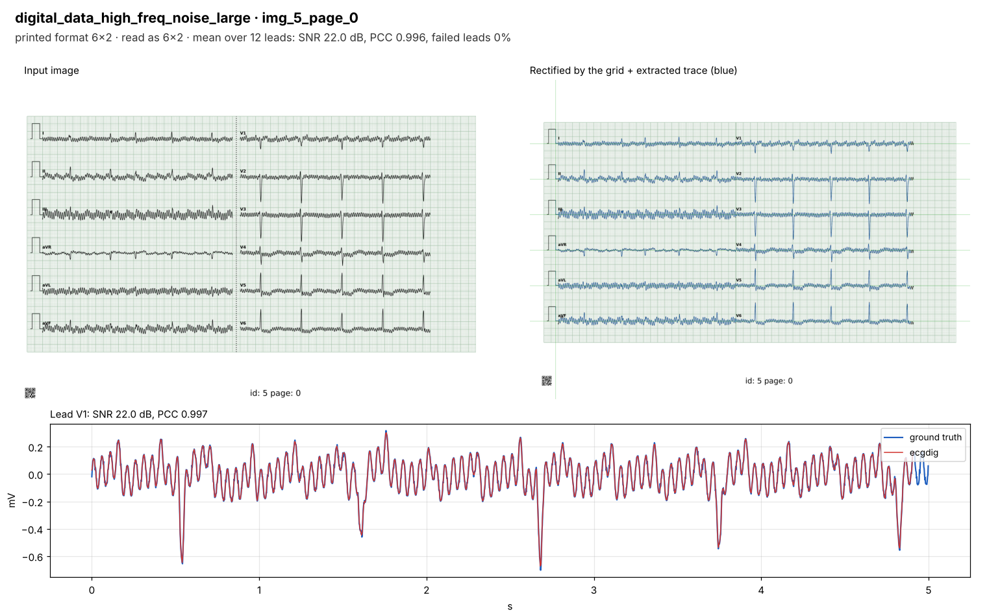 |
| Strong perspective, 3x4 + 3 rhythm strips (17.9 dB) | Digital page with heavy high-frequency noise, 6x2 (22.0 dB) |
| 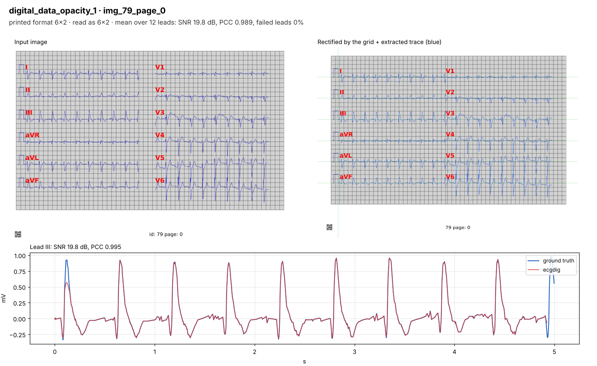 | |
| Blue trace on a black grid, 18 mm between the columns: chroma ink map and wide column gap (19.8 dB; −3.8 dB before) | |

### Typical

| | |
|---|---|
| 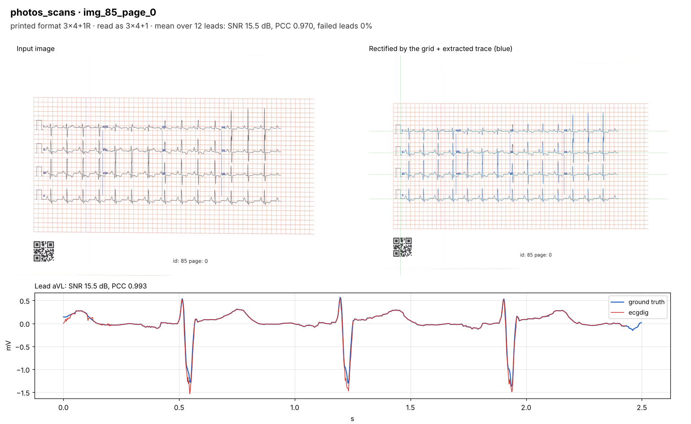 | 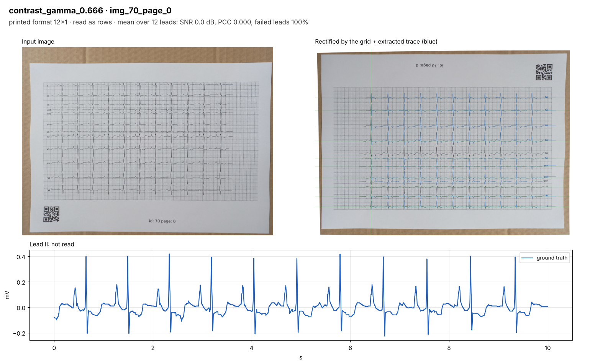 |
| Desk scan near the scenario median (15.5 dB) | 12x1 whose rows are 2–8 mm apart and cross: the close rows are now found (10.4 dB; 0 dB before) |

### Bad

| | |
|---|---|
| 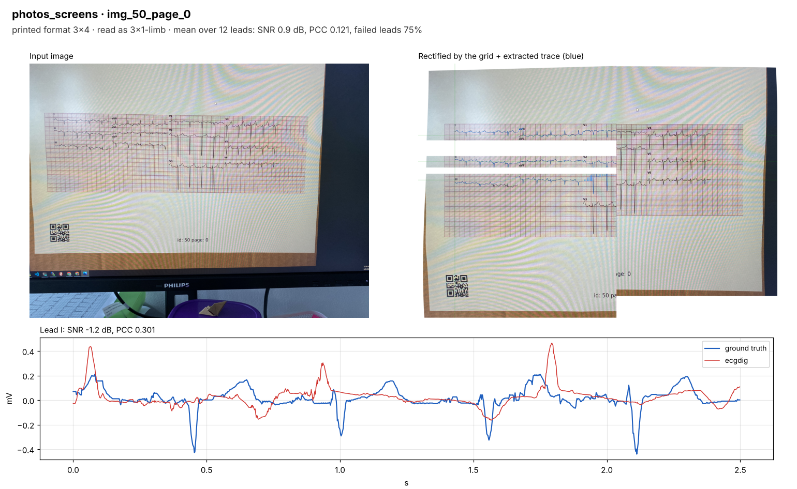 | 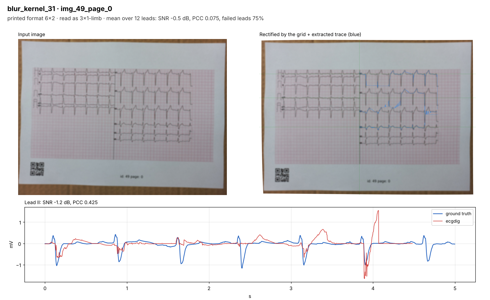 |
| Photo of a screen (moiré): the columns are split in the wrong place and the page is read as one sheet of a two-sheet 3x2 | Blur 31: trace and grid merge; a 6x2 page read as three strips |
| 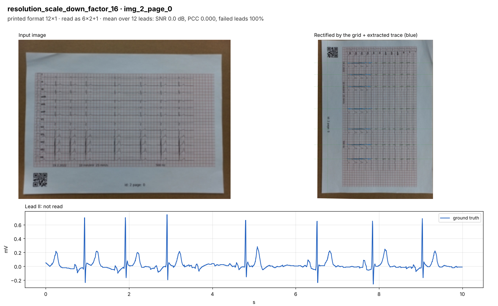 | 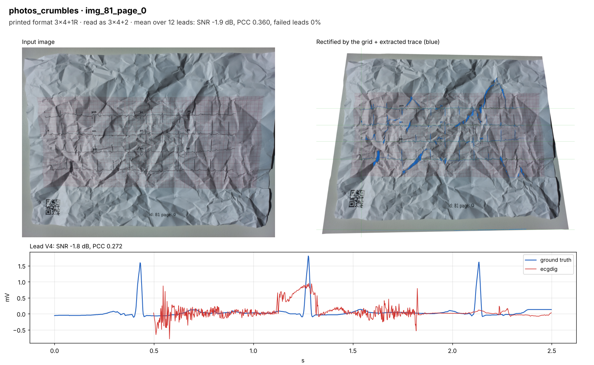 |
| Resolution 1/16: a 12x1 page read as 6x2 + rhythm, no lead aligns | Crumpled paper: the grid is lost in the folds |
| 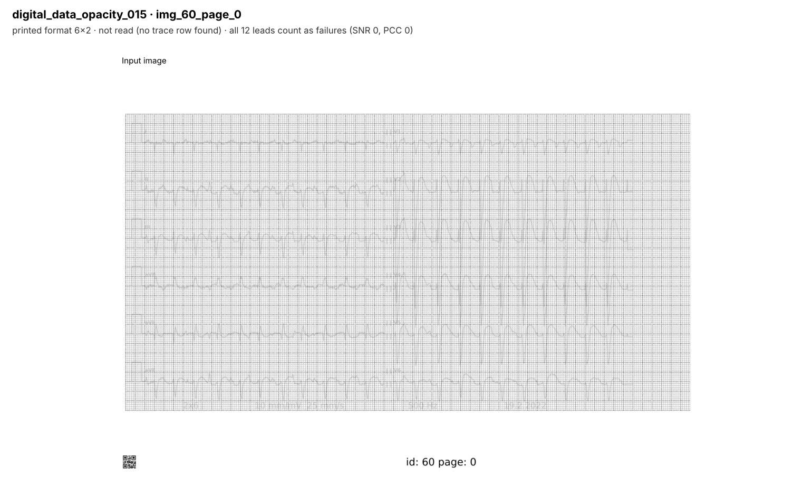 | |
| Opacity 0.15: no trace row is found | |

## Install and use

```bash
pip install -e .
python -m ecgdig ecg.jpg -o out              # out.csv, out.json, out_debug.jpg
python -m ecgdig ecg.jpg --layout 6x2 --ppmm 11.81   # force a layout; 300 dpi = 11.81 px/mm
```

```python
from ecgdig import digitize, Config
res = digitize("ecg.jpg")            # Config() finds layout, speed, duration and gain
res["signals"]        # (12, 5000) float32 in mV; NaN where the lead is not on the paper
res["layout"], res["layout_info"]["confidence"], res["quality"]["global"]
```

Layout hypotheses: `3x4`, `3x4+1/+2/+3`, `6x2`, `6x2+1`, `12x1`, 6-strip pages (`6x1-prec` V1–V6, `6x1-limb` I–aVF) and 3-strip pages, all also in **Cabrera** order (aVL, I, −aVR, II, aVF, III), with free-named rhythm strips and split gain (limb 10 / precordial 5 mm/mV). Outside the library a "free" hypothesis builds the layout from the boundaries and the OCR. A layout can be forced with `Config(layout="6x2")` or `Config(layout=[["I", "V1"], ["II", "V2"]])`.

## Hybrid mode (optional)

A small network can replace only the ink map (where the pen ink is); grid, layout, pulses, time axis and tracking stay classical. With `Config(ink_model="trace_seg.onnx")` the page is read with both ink maps and the reading with the better internal quality is kept. The network is trained on generic synthetic crops only (no template, no image from the benchmarks). Status and plan: [`docs/hybrid.md`](docs/hybrid.md).

## Pipeline

| Stage | Technique |
|---|---|
| Paper | scan test (border as bright as the centre); otherwise GrabCut with border = background and a convex hull, with paper-coloured border pixels kept out of the background seeds; Otsu on the background colour when GrabCut leaks; crop to the sheet when it fills < 30% of the frame |
| Deskew and scale | variance of the projections; grid period by block autocorrelation, with 5 mm vs 1 mm and harmonic checks; scale from the sheet when the grid gives an impossible one |
| Rectification | local Fourier phase of the grid + quality-guided 2D unwrapping seeded in the largest good region → correspondences → RANSAC homography |
| Non-flat paper | 1 mm phase residual → cubic polynomial, then a local field on 5 mm cells (creases), Wiener-shrunk by its own noise; then every major (5 mm) and minor (1 mm) line located one by one, with the trace masked out by colour |
| Grid removal | transmittance model (ink × grid): periodic template by local median (25 mm neighbourhood) + residual per straight row/column; dark grids reached down to the line |
| Binarization | Otsu on thin structures only + hysteresis above the measured grid leakage; local contrast boost per 5 cm block; leftover straight grid pieces and one-sided long vertical lines (grid border) removed |
| Columns | blank gaps (labels inside the gap allowed), equal-width hypotheses or baseline tracks that end and start at column changes; columns with their own row heights moved to stacked rows; QR code and footer rows ignored |
| Rows | horizontal coverage peaks filtered by "looks like a trace"; rows from calibration pulses; common rhythm between rows (simultaneous QRS) to drop headers, rulers and frames |
| Layout | hypothesis and verification: classical OCR of the labels (template matching with TrueType fonts), boundary marks, Einthoven/Goldberger closure, duplicate agreement and a library prior; confidence from the margin; 0/180° decided by the layout when pulses and labels do not |
| Speed and gain | "NN mm/s" read from the text and checked by QRS width / RR; gain per row from the 1 mV pulse (step pulse = split gain), snapped to standard values |
| Time origin | sub-pixel left/right edges of each row vote for x₀; beat registration across rows corrects residual shear |
| Tracking | Viterbi over the ink segments of each column: continuity, saturated baseline prior, penalty for flat stretches on another lead's baseline, rigid translation of steep strokes, weak-ink bridges, failure state |
| Centre line | morphological inversion of an elliptical pen (opening of the top edge, closing of the bottom edge), then analysis-by-synthesis (Gaussian pen + blur estimated on the image) on thin traces |
| Fusion | confidence-weighted mean of repeated copies; least-squares projection onto I − II + III = 0 and aVR + aVL + aVF = 0, with occluded samples absorbing the correction |
| Quality | per-lead and per-page score without ground truth (`res["quality"]`) |

## Benchmarks and tests

```bash
pytest -q tests                                     # fast regression (synthetic pages, structure, speed paths)
python -m ecgdig.synth data/test 15 heavy 3x4+1     # synthetic pages with ground truth
python -m ecgdig.evaluate data/test                 # SNR per image and per lead
```

- [`benchmarks/pmcardio/`](benchmarks/pmcardio/): PM-ECG-ID, locally on a sample or the whole database on GitHub Actions, with ablation switches.
- [`benchmarks/physionet/`](benchmarks/physionet/): Kaggle PhysioNet training images, with an oracle error decomposition and an HTML report.
- [`benchmarks/litfl/`](benchmarks/litfl/): 102 real pages with a hand-reviewed structural reference.
- `scripts/make_gallery.py`, `scripts/example_figure.py`, `scripts/internet_figures.py`: the figures in `docs/`.

## Known limitations

- Rows whose traces cross (2–8 mm apart) cannot be separated by horizontal bands; the amplitude where two tall QRS merge is genuinely ambiguous and falls back on another copy of the lead or on Einthoven.
- At internal 3x4 boundaries the separator mark hides ~10 ms on each side; a QRS exactly there is extrapolated.
- When the trace starts right at the falling edge of the pulse, t = 0 depends on the device convention (up to ~±50 ms, the same for all leads).
- Without any grid, the scale comes from `--ppmm` or from the sheet size.
- Heavy blur, very low resolution, crumpled paper and near-invisible traces remain the weak points.

## License

Apache-2.0 (see [`LICENSE`](LICENSE) and [`NOTICE`](NOTICE)). The figures in `docs/gallery/` are derived from PM-ECG-ID images and stay under GPL-3.0-or-later, like their source.

## References

- Demolder A et al. High precision ECG digitization using artificial intelligence. medRxiv 2024.08.31.24312876.
- Iring A et al. PMcardio ECG Image Database (PM-ECG-ID). Zenodo, 2024. doi:10.5281/zenodo.13617673.
- Reyna MA et al. Digitization and classification of ECG images: the George B. Moody PhysioNet Challenge 2024.
- Shivashankara KK et al. ECG-Image-Kit: a synthetic image generation toolbox to facilitate deep learning-based electrocardiogram digitization. Physiol Meas, 2024.
- Badilini F et al. ECGScan: a method for conversion of paper electrocardiographic printouts to digital electrocardiographic files. J Electrocardiol, 2005.
- Ghiglia DC, Pritt MD. Two-Dimensional Phase Unwrapping: Theory, Algorithms, and Software. Wiley, 1998.
- Hartley R, Zisserman A. Multiple View Geometry in Computer Vision. Cambridge, 2004.
- Fischler MA, Bolles RC. Random sample consensus. Commun ACM, 1981.
- Rother C, Kolmogorov V, Blake A. GrabCut: interactive foreground extraction using iterated graph cuts. SIGGRAPH, 2004.
- Serra J. Image Analysis and Mathematical Morphology. Academic Press, 1982.
- Otsu N. A threshold selection method from gray-level histograms. IEEE SMC, 1979.
- Viterbi AJ. Error bounds for convolutional codes and an asymptotically optimum decoding algorithm. IEEE Trans Inf Theory, 1967.
