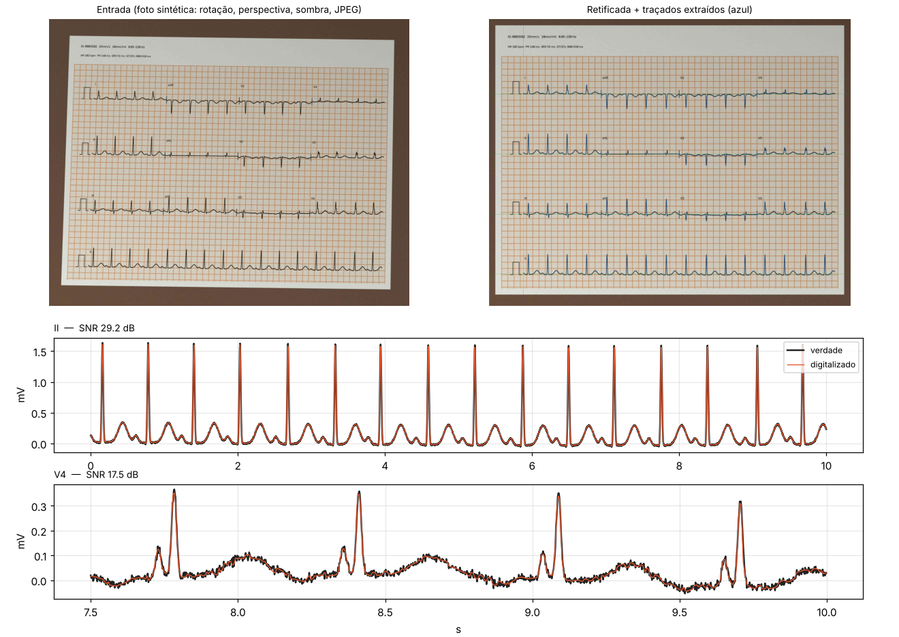

# ecgdig — digitalizador clássico de ECG (sem deep learning)

Converte a imagem de um ECG em papel (scan, PDF rasterizado ou foto) em sinais de 12 derivações em mV, a 500 Hz, usando apenas visão computacional clássica: geometria da grade, morfologia matemática, programação dinâmica e restrições fisiológicas. Não há nenhum modelo treinado.



## Uso

```bash
pip install -e .
python -m ecgdig exame.jpg -o saida          # saida.csv, saida.json, saida_debug.jpg
python -m ecgdig exame.jpg --layout 6x2 --ppmm 11.81   # 300 dpi = 11.81 px/mm
```

```python
from ecgdig import digitize, Config
res = digitize("exame.jpg", Config(layout="auto"))
res["signals"]   # (12, 5000) em mV; NaN onde a derivação não aparece no papel
```

Layout, velocidade, duração e ganho são **descobertos na imagem** (`Config()` sem argumentos). Biblioteca de hipóteses: `3x4`, `3x4+1/+2/+3`, `6x2`, `6x2+1`, `12x1`, páginas de 6 tiras (`6x1-prec` V1–V6, `6x1-limb` I–aVF), todas também na ordem de **Cabrera** (aVL, I, −aVR, II, aVF, III), com tiras de ritmo de nome livre e ganho dividido (membros 10 / precordiais 5 mm/mV). Fora da biblioteca, uma hipótese "livre" monta o layout pelas fronteiras e pelo OCR. Também dá para forçar: `Config(layout="6x2")` ou `Config(layout=[["I","V1"],["II","V2"]])`.

## Pipeline

| Etapa | Técnica |
|---|---|
| Segmentação da folha | Teste de scan (borda tão clara quanto o centro); senão GrabCut com borda = fundo e envoltória convexa |
| Mapa da grade | Normalização de iluminação por filtro de máximo; tinta atenuada para não contaminar a geometria |
| Deskew e escala | Maximização da variância das projeções; período por autocorrelação em blocos, com detecção de linha de 5 mm vs 1 mm e de múltiplos do período |
| Retificação | Fase de Fourier local da grade em blocos + *unwrapping* 2D guiado por qualidade → correspondências → homografia (RANSAC) |
| Papel curvo | Resíduo de fase da linha de 1 mm → campo de deslocamento polinomial cúbico → `remap` |
| Remoção da grade | Modelo de transmitância (tinta × grade): molde periódico mod 5 mm por mediana **local** (vizinhança de 25 mm) + resíduo por linha/coluna reta (percentil 80) — qualquer cor de grade, foco/iluminação variáveis |
| Binarização | Otsu calculado só sobre estruturas finas (tarjas, carimbos e blocos pretos > 2.5 mm excluídos, senão apagam traçado claro) + histerese com limiar baixo acima do vazamento medido da grade; remoção de componentes minúsculas |
| Linhas | Picos de cobertura horizontal, filtrados por "parecer traçado": longo depois de juntar quebras **e** longo sem juntar (rodapé de texto só é longo dilatado); réguas retas (borda da área quadriculada) removidas por abertura de 60 mm; orientação 0/90/180/270° por alongamento + posição dos pulsos |
| Layout (hipótese e verificação) | Cada layout candidato é pontuado por: OCR clássico dos rótulos (casamento de modelos com fontes TrueType, NCC, refinamento do último caractere, setas/pontos aparados), marcas de fronteira, fechamento de Einthoven/Goldberger nas derivações de membros, concordância de derivações repetidas (NRMSE) e prior de biblioteca; confiança = sigmoide da margem |
| Velocidade / ganho | Leitura do texto "NN mm/s" (com modelos negativos mm/mV, Hz); senão largura do QRS / RR. Ganho por linha pelo pulso (pulso em degrau = ganho dividido) |
| Calibração | Pulso de 1 mV (exige platô horizontal; aceita "meio pulso" cortado pela margem): ganho com ajuste a 5/10/20 mm/mV; 0 mV = platô − 1 mV (o pé do pulso é ambíguo, o platô não) |
| Origem temporal | Bordas sub-pixel esquerda/direita de cada linha votam no x₀; com os dois lados, a média cancela o viés da ponta do traço |
| Registro entre linhas | Todas as derivações são simultâneas: os QRS (centróide de energia) de todas as linhas definem uma referência comum; deslocamento e escala por linha, lineares na altura, corrigem cisalhamento residual da retificação em fotos |
| Rastreamento | Viterbi sobre os segmentos de tinta de cada coluna: continuidade, prior saturado da linha de base (R de 3–5 mV são fisiológicos), penalidade para trechos planos sobre a linha de base de outra derivação, estado de falha |
| Linha central | **Inversão morfológica**: o traço é a curva dilatada por uma pena elíptica. Borda de cima = erosão, de baixo = dilatação; abertura e fechamento recuperam a curva, exatos em picos e vales (amplitude do R preservada). Largura horizontal da pena medida nos QRS |
| Sobreposição | Bordas que caem dentro da tinta de um traço vizinho plano são tratadas como oclusão e interpoladas |
| Bordas de segmento | Descarte de ~1 raio de pena nas fronteiras internas (marcas separadoras) com extrapolação amortecida |
| Fusão | Média ponderada por confiança entre ocorrências repetidas (amostras em que o traço se funde com o de outra linha valem 5%) e projeção de mínimos quadrados em I − II + III = 0 e aVR + aVL + aVF = 0, em que as amostras ocluídas absorvem a correção; opcionalmente reconstrói derivações de membros por Goldberger |

## Resultados

Conjunto **de teste separado** (semente diferente da usada no desenvolvimento), 15 imagens por nível, 3x4+1, 150–300 dpi. SNR calculado só nas amostras visíveis de cada derivação, sem alinhamento posterior.

| Degradação | SNR médio | Mediana por imagem | Pior imagem | Correlação |
|---|---|---|---|---|
| Nenhuma (scan perfeito) | 22.4 dB | 22.7 dB | 19.3 dB | 0.995 |
| Leve | 21.2 dB | 21.9 dB | 16.6 dB | 0.992 |
| Média (foto: rotação, perspectiva, sombra, JPEG) | 21.6 dB | 22.3 dB | 17.2 dB | 0.993 |
| Pesada | 19.4 dB | 20.7 dB | 10.8 dB | 0.988 |

Outros layouts (degradação leve): 3x4 21.8 dB, 6x2 22.0 dB, 3x4+3 22.0 dB, 12x1 21.1 dB. Cerca de 8–12 s por imagem em CPU.

### Fotos reais (sem ground truth): autoconsistência

Sem sinal verdadeiro, a métrica honesta é a concordância entre as duas cópias independentes da mesma derivação (grade × tira de ritmo, mesmo instante) e o fechamento de Einthoven (I − II + III = 0) antes da fusão.

| | Foto 1 (685 px, ~2.6 px/mm) | Foto 2 (celular, ~6.7 px/mm) |
|---|---|---|
| II grade × ritmo (fora de oclusões) | r 0.90, 62 µV RMS | r 0.96, 48 µV RMS |
| V1 grade × ritmo | r 0.995, 19 µV RMS | r 0.98, 95 µV RMS |
| V5 grade × ritmo | r 0.71, 239 µV RMS | r 0.83, 228 µV RMS |
| Resíduo de Einthoven | 70 µV (RMS de II: 522 µV) | 90 µV (RMS de II: 257 µV) |

As discordâncias que sobram ficam concentradas em QRS: onde um R de 3 mV atravessa a linha vizinha exatamente no mesmo instante do R dela (foto 1) e num R que cai na fronteira entre colunas (V5 da foto 2).

**Checagem externa** com imagens do ECG-Image-Kit (o gerador usado no PhysioNet Challenge 2024, renderizador independente deste código) contra o registro PTB-XL 00001: a versão com dobras e vincos dá correlação média 0.92.

### Imagens reais da internet (layout, velocidade e duração automáticos)

Imagens públicas dos repositórios [Open-ECG-Digitizer](https://github.com/Ahus-AIM/open-ecg-digitizer) e [paper-ecg](https://github.com/Tereshchenkolab/paper-ecg); figuras em `docs/internet/`.

| Imagem | Na folha | Detectado |
|---|---|---|
| GE/Marquette, scan | 3x4 + ritmo V1, II · 25 mm/s | ✔ (V1 e II duplicados concordam a 8–12 µV, r 0.98–0.999; Einthoven 16 µV com II de 285 µV RMS) |
| Mesmo GE, scan girado | idem | ✔ |
| Schiller/Mortara, 3 scans | V1–V6 · 50 mm/s | ✔ (velocidade lida do texto "50mm/s") |
| Schiller, foto de celular em perspectiva | V1–V6 · 50 mm/s | ✔ |
| Foto com rótulos apagados | provavelmente V1–V6 | ✘ "6x1-limb-cabrera" (confiança 0.78) |

O caso que falha é uma ambiguidade física: precordiais em ordem varrem o tórax como o leque de Cabrera e quase fecham Goldberger; sem rótulos impressos, só a forma de onda não separa as duas hipóteses.

**Regressão sintética** (após as mudanças acima): conjunto misto de teste separado (Cabrera, ganho dividido, 50 mm/s, 3x4/+1/+2/+3, 6x2/+1, 12x1) 24/24 layouts corretos, velocidade 22/24, SNR médio 18.4 dB; `bench/medium` 21.6 dB; layouts fixos 21.0–22.0 dB; `pytest` 3/3.

Os números sintéticos não são comparáveis diretamente com o placar do PhysioNet 2024: lá as imagens são mais variadas, e o gerador sintético daqui é mais fácil do que o mundo real.

## Limitações conhecidas

- Quando dois QRS altos de linhas vizinhas caem no mesmo instante, a tinta se funde numa única barra vertical e a amplitude de um deles fica genuinamente ambígua; o método marca essas amostras como pouco confiáveis e recorre à outra cópia da derivação ou a Einthoven, mas sem cópia redundante (ex.: V4) o pico pode sair subestimado.
- Nas fronteiras internas do 3x4, a marca separadora esconde ~10 ms de cada lado; um QRS exatamente ali é extrapolado.
- Folha cortada pela borda da imagem: se as duas pontas de todas as linhas estiverem fora, a origem temporal fica sem referência.
- Quando o traço começa colado à descida do pulso, o t = 0 depende da convenção do aparelho (pode haver ~±50 ms de deslocamento global, igual em todas as derivações).
- Sem grade nenhuma, a escala vem de `--ppmm` ou de uma suposição de largura de página.
- Papel muito amassado (dobras com sombra forte) e fotos com desfoque de movimento continuam sendo o ponto fraco de qualquer método clássico.

## Validação

```bash
python -m ecgdig.synth data/teste 15 heavy 3x4+1   # gera imagens + ground truth
python -m ecgdig.evaluate data/teste               # SNR por imagem e por derivação
pytest -q tests
```

## Referências

- Reyna MA et al. Digitization and classification of ECG images: the George B. Moody PhysioNet Challenge 2024.
- Shivashankara KK et al. ECG-Image-Kit: a synthetic image generation toolbox to facilitate deep learning-based electrocardiogram digitization. Physiol Meas, 2024.
- Badilini F et al. ECGScan: a method for conversion of paper electrocardiographic printouts to digital electrocardiographic files. J Electrocardiol, 2005.
- Ghiglia DC, Pritt MD. Two-Dimensional Phase Unwrapping: Theory, Algorithms, and Software. Wiley, 1998.
- Hartley R, Zisserman A. Multiple View Geometry in Computer Vision. Cambridge, 2004.
- Fischler MA, Bolles RC. Random sample consensus. Commun ACM, 1981.
- Rother C, Kolmogorov V, Blake A. GrabCut: interactive foreground extraction using iterated graph cuts. SIGGRAPH, 2004.
- Serra J. Image Analysis and Mathematical Morphology. Academic Press, 1982.
- Otsu N. A threshold selection method from gray-level histograms. IEEE SMC, 1979.
- Viterbi AJ. Error bounds for convolutional codes and an asymptotically optimum decoding algorithm. IEEE Trans Inf Theory, 1967.
